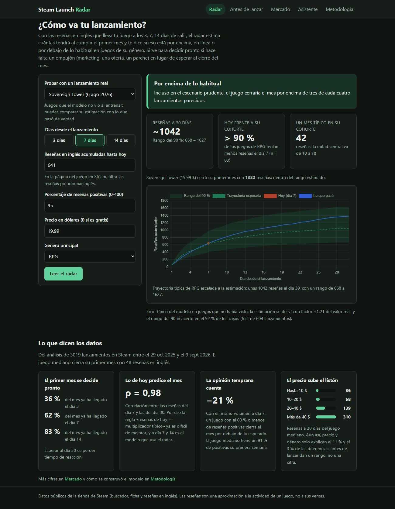
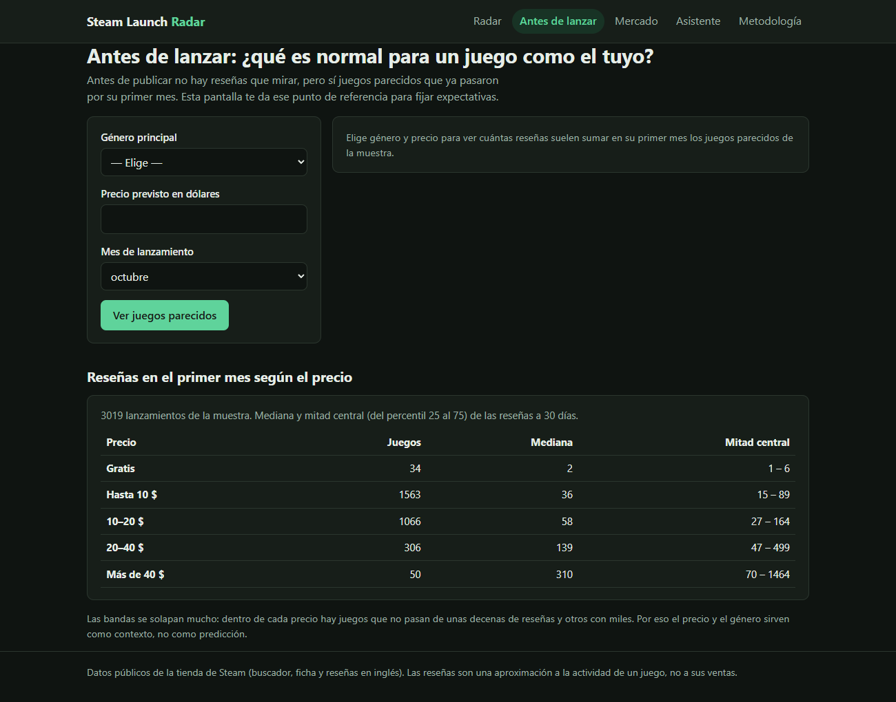
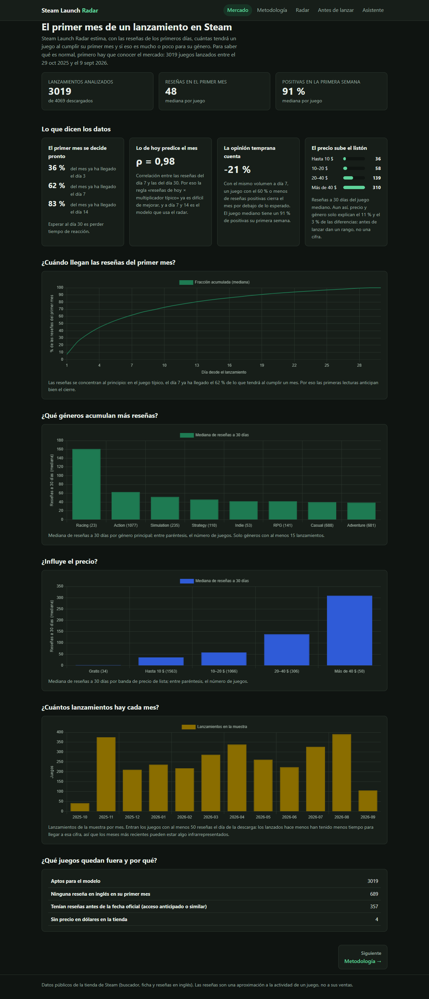

# Steam Launch Radar

Un estudio pequeño que publica un juego en Steam pasa el primer mes a ciegas: ve
entrar reseñas, pero no sabe si son muchas o pocas para un juego como el suyo hasta
que ya es tarde para reaccionar. **Steam Launch Radar** toma las reseñas de los
primeros 3, 7 o 14 días, estima cuántas tendrá el juego al cumplir 30 y dice si eso
está por encima, en línea o por debajo de lo habitual en su género. Antes del
lanzamiento, en lugar de inventar una cifra, enseña el rango de juegos parecidos.

**Aplicación:** _pendiente de publicar en Vercel (ver [Despliegue](#despliegue-en-vercel))._



---

## 1. Problema y usuario

El usuario es quien lleva el lanzamiento en un estudio indie o en un editor pequeño.
En la primera semana tiene que decidir si refuerza el marketing, adelanta una oferta o
prioriza un parche, y solo cuenta con un número suelto: las reseñas que lleva. Con el
radar introduce ese número (más el precio, el género y el porcentaje de positivas) y
obtiene:

- una estimación de las reseñas a 30 días con un rango del 90 %,
- dónde queda frente a los lanzamientos de su género,
- un veredicto que solo se pronuncia cuando todo el rango queda por encima o por
  debajo de lo normal.

Antes no tenía con qué compararse: SteamDB o la propia tienda muestran juegos uno a
uno, no cómo suele evolucionar un lanzamiento parecido en su primer mes.

## 2. Datos

| Fuente | Qué aporta | Acceso |
| --- | --- | --- |
| Buscador de la tienda de Steam (`store.steampowered.com/search/results`) | Todos los lanzamientos de un periodo, ordenados por fecha, con su número de reseñas | Sin clave; la ruta `/search/` no está excluida en el `robots.txt` |
| Ficha de la tienda (`store.steampowered.com/api/appdetails`) | Fecha de lanzamiento, precio de lista en dólares y géneros | Sin clave, unas 200 peticiones cada 5 minutos |
| Steam Web API (`IUserReviewsService/GetAppReviews`) | Fecha y voto de cada reseña pública | Sin clave; [condiciones de la Steam Web API](https://steamcommunity.com/dev/apiterms) |

- **Muestra:** todos los juegos del buscador lanzados entre el 29-10-2025 y el
  09-09-2026 con entre 50 y 10.000 reseñas: 4.069 juegos, de los que 3.019 son aptos
  para el modelo. Descarga del 24-10-2026.
- **Dos límites de la API sin clave**, comprobados al construir la ingesta: solo
  devuelve reseñas en inglés (en el juego mediano, el 40 % del total) y solo las del
  último año. Por eso todas las cifras son reseñas en inglés y la muestra se limita a
  los lanzamientos de los últimos doce meses.
- **Privacidad:** de cada reseña solo se guardan la fecha y el voto, agregados por día.
  El texto y el identificador del autor se descartan al leer la página.
- **Obtención:** `python -m radar.ingesta` descarga todo (1-2 horas por los límites de
  las APIs; se puede cortar y reanudar). Las tablas procesadas ya vienen en el
  repositorio, así que no hace falta para usar la app.

Diccionario de las tablas de `data/processed/`:

| Tabla | Filas | Columnas principales |
| --- | --- | --- |
| `juegos.csv` | 4.069 | `appid`, `nombre`, `fecha_lanzamiento`, `precio_usd`, `genero_principal`, `banda_precio`, `resenas_30d`, `pct_previas`, `estado` (apto o motivo de exclusión) |
| `resenas_diarias.csv` | una por juego y día con reseñas, del día −30 al 89 | `appid`, `dia` (0 = lanzamiento), `positivas`, `negativas`, `resenas` |
| `dataset_radar.csv` | 3.019 | variables previas al lanzamiento, `resenas_{3,7,14}d`, `pct_positivas_{3,7,14}d` y el objetivo `resenas_30d` |

## 3. Preprocesamiento y EDA

[`notebooks/01_preproceso.ipynb`](notebooks/01_preproceso.ipynb) recorre la limpieza
con los datos reales; la lógica vive en `src/radar/preparacion.py`.

- Cada reseña se sitúa en su día relativo a la fecha oficial de lanzamiento.
- Se excluyen 689 juegos sin ninguna reseña en inglés en su primer mes, 357 con más del
  5 % de sus reseñas antes de la fecha oficial (salieron de acceso anticipado: su día 0
  no es un estreno) y 4 sin precio en dólares.
- El volumen es muy asimétrico (mediana de 48 reseñas a 30 días, media de 220): se
  trabaja en log(1 + reseñas). Los juegos más grandes son lanzamientos reales y no se
  recortan.

[`notebooks/02_eda.ipynb`](notebooks/02_eda.ipynb) responde siete preguntas. Las que
deciden el producto:

- **Las reseñas llegan pronto:** el día 3 ya está el 36 % del mes, el día 7 el 62 % y
  el día 14 el 83 %. Esperar al día 30 es perder tiempo de reacción.
- **La relación es casi lineal en log** (ρ de Spearman de 0,98 entre el día 7 y el 30): la
  regla «reseñas de hoy × multiplicador típico» ya es un baseline exigente.
- **La opinión temprana cuenta:** con el mismo volumen a día 7, un juego con el 60 % o
  menos de positivas acaba un 21 % por debajo de lo esperado.
- **Antes de lanzar, el precio y el género explican poco** (ε² de 0,11 y 0,03): sirven
  para situar un rango, no para dar una cifra.
- **Sesgo de selección:** la mediana a 30 días sube trimestre a trimestre (36 → 60)
  porque los lanzamientos recientes necesitan ser más grandes para tener 50 reseñas el
  día de la descarga.

## 4. Ciencia de datos

[`notebooks/03_modelo.ipynb`](notebooks/03_modelo.ipynb) y `src/radar/modelo.py`.

- **Objetivo:** log(1 + reseñas en inglés a 30 días).
- **Partición por fecha de lanzamiento:** 1.811 juegos de entrenamiento, 604 de
  calibración y 604 de test (los más recientes, de julio a septiembre de 2026).
- **Candidatos:** la mediana, el ratio típico de la cohorte (la regla de la hoja de
  cálculo), Ridge y gradient boosting. Se elige por validación cruzada temporal dentro
  del entrenamiento; el test se usa una sola vez.
- **Intervalo del 90 %:** conformal, con el cuantil de los errores en el bloque de
  calibración.

Resultado en test, sobre lanzamientos que el modelo no vio:

| Lectura | Modelo elegido | Factor de error típico | Dentro de ×2 | Cobertura del rango del 90 % |
| --- | --- | --- | --- | --- |
| Día 3 | Ridge | ×1,34 | 92 % | 93 % |
| Día 7 | Ratio de la cohorte | ×1,21 | 98 % | 92 % |
| Día 14 | Ratio de la cohorte | ×1,09 | 99,5 % | 93 % |
| Antes de lanzar | Gradient boosting | ×2,56 (la mediana: ×2,39) | 37 % | 92 % |

«Factor de error típico» es la desviación en el juego mediano: ×1,21 significa que la
estimación queda entre un 17 % por debajo y un 21 % por encima del valor real.

- **A día 7 y 14 gana la regla simple.** Ridge y gradient boosting quedan dentro del
  ruido entre pliegues, y casi todo el peso está en las reseñas acumuladas. Se respeta
  lo que dice la validación: más complejidad sin mejora fuera de muestra solo añade
  riesgo.
- **Antes de lanzar no hay modelo útil.** El elegido baja el error medio pero empeora el
  del juego típico, también sin el mes de lanzamiento. Por eso la app no da una cifra
  previa y muestra el rango de juegos parecidos.
- **Limitaciones:** las reseñas en inglés son una aproximación a la actividad, no a las
  ventas; la muestra deja fuera los lanzamientos con menos de 50 reseñas y los éxitos
  con más de 10.000; en el periodo de test el modelo sobreestima en torno a un 11 % los
  juegos de 10 a 200 reseñas a día 7 (el rango lo absorbe, pero hay que vigilarlo al
  reentrenar).

## 5. La aplicación

App Next.js con la inferencia en el servidor: los modelos se exportan desde Python a
JSON (`python -m radar.exportar`) y se evalúan en TypeScript. Los tests de la app
comprueban, con 2.416 casos calculados en Python, que dan exactamente lo mismo.

| Sección | Qué hace |
| --- | --- |
| **Radar** (`/`) | Estimación a 30 días, comparación con la cohorte, veredicto y trayectoria esperada. Se puede probar con 604 lanzamientos reales del test y ver lo que pasó después. Admite enlaces del tipo `/?juego=4113940&dia=7`. |
| **Antes de lanzar** | Reseñas a 30 días de juegos del mismo género y precio (mediana y mitad central). |
| **Mercado** | Panel con los indicadores de la muestra: ritmo del primer mes, géneros, precio, lanzamientos por mes y exclusiones. |
| **Metodología** | Datos, comparación de candidatos, métricas de test y limitaciones, leídas de los mismos JSON. |

Las entradas se validan en el servidor (`POST /api/radar`, `POST /api/previo`) con
mensajes que nombran el campo erróneo. Si faltan los datos exportados, cada página lo
dice y explica cómo generarlos.

| Antes de lanzar | Mercado |
| --- | --- |
|  |  |

## 6. Instalación y ejecución

Requisitos: Python 3.13 y Node.js 20 o superior.

```bash
git clone <url-del-repositorio> steam-launch-radar
cd steam-launch-radar

# Python (solo hace falta para regenerar datos, notebooks o modelos)
python -m venv .venv
.venv\Scripts\activate            # Windows; en Linux o macOS: source .venv/bin/activate
pip install -r requirements.txt

# Aplicación: un único comando con los datos ya incluidos
cd app
npm install
npm run dev                       # http://localhost:3000
```

Para rehacerlo todo desde cero:

```bash
python -m radar.ingesta           # descarga (1-2 h, reanudable)
python -m radar.preparacion       # data/processed/*.csv
python -m radar.exportar          # app/data/*.json y casos de prueba de la app
```

Comprobaciones: `ruff check .`, `pytest` y, en `app/`, `npm run lint`,
`npm run typecheck`, `npm test` y `npm run build`. El CI de GitHub Actions las ejecuta
en cada push.

### Despliegue en Vercel

En Vercel, «Add New Project», importar el repositorio y fijar **Root Directory =
`app`**. No necesita variables de entorno: los modelos y datos viajan en `app/data/`.

## 7. Estructura del repositorio

```
steam-launch-radar/
├── README.md
├── LICENSE                   MIT (el código; los datos son de Steam)
├── requirements.txt          versiones exactas; instala también el paquete radar
├── .env.example              solo un correo opcional para el User-Agent
├── data/
│   ├── raw/                  caché de la ingesta (no se versiona)
│   └── processed/            juegos, reseñas diarias y dataset del modelo
├── notebooks/                01_preproceso · 02_eda · 03_modelo
├── src/radar/
│   ├── ingesta/              buscador, ficha y reseñas de Steam (reanudable)
│   ├── preparacion.py        limpieza, exclusiones y variables
│   ├── modelo.py             partición temporal, candidatos e intervalo conformal
│   └── exportar.py           modelos y tablas para la app
├── tests/                    pytest: ingesta, preparación, modelo y exportación
├── app/                      Next.js: páginas, API e inferencia en TypeScript
└── docs/capturas/
```

## 8. Qué mejoraría con más tiempo

- **Reseñas en todos los idiomas.** La API sin clave solo sirve las de inglés; con una
  clave de la Steam Web API habría que comprobar si devuelve el resto y si el radar
  mejora para juegos con público no anglófono, hoy excluidos si no reciben reseñas en
  inglés.
- **Reentrenamiento mensual automático.** Un workflow que descargue los lanzamientos que
  van cerrando su primer mes y vigile el sesgo de sobreestimación visto en el test.
- **Muestra sin sesgo de selección.** Fijar la entrada por las reseñas del día 30 en
  lugar de las del día de descarga, guardando el recuento del buscador en varias fechas.
- **Más señales tempranas.** Jugadores simultáneos (CCU) o seguidores en la página de la
  tienda para mejorar la lectura del día 3, la más útil y la menos precisa.
