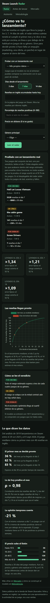
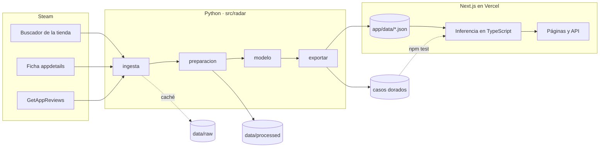

# Steam Launch Radar

Estima con las reseñas de los primeros días cuántas tendrá un juego de Steam al cumplir
su primer mes y si eso es mucho o poco para su género.

**Aplicación:** <https://steam-launch-radar.vercel.app>


Un estudio pequeño que publica un juego en Steam pasa el primer mes a ciegas: ve
entrar reseñas, pero no sabe si son muchas o pocas para un juego como el suyo hasta
que ya es tarde para reaccionar. **Steam Launch Radar** toma las reseñas de los
primeros 3, 7 o 14 días, estima cuántas tendrá el juego al cumplir 30 y dice si eso
está por encima, en línea o por debajo de lo habitual en su género. Antes del
lanzamiento, en lugar de inventar una cifra, enseña el rango de juegos parecidos.

---

## 1. Problema y usuario

El usuario es quien lleva el lanzamiento en un estudio indie o en un editor pequeño.
En la primera semana tiene que decidir si refuerza el marketing, adelanta una oferta o
prioriza un parche, y solo cuenta con un número suelto: las reseñas que lleva. Con el
radar introduce ese número (más el precio, el género y el porcentaje de positivas) y
obtiene:

- una estimación de las reseñas a 30 días con un rango del 90 %,
- dónde queda frente a los lanzamientos de su género,
- un veredicto que solo se pronuncia cuando todo el rango queda por encima o por
  debajo de lo normal.

Antes no tenía con qué compararse: SteamDB o la propia tienda muestran juegos uno a
uno, no cómo suele evolucionar un lanzamiento parecido en su primer mes.

## 2. Datos

| Fuente | Qué aporta | Acceso |
| --- | --- | --- |
| Buscador de la tienda de Steam (`store.steampowered.com/search/results`) | Todos los lanzamientos de un periodo, ordenados por fecha, con su número de reseñas | Sin clave; la ruta `/search/` no está excluida en el `robots.txt` |
| Ficha de la tienda (`store.steampowered.com/api/appdetails`) | Fecha de lanzamiento, precio de lista en dólares y géneros | Sin clave, unas 200 peticiones cada 5 minutos |
| Steam Web API (`IUserReviewsService/GetAppReviews`) | Fecha y voto de cada reseña pública | Sin clave; [condiciones de la Steam Web API](https://steamcommunity.com/dev/apiterms) |

- **Muestra:** todos los juegos del buscador lanzados entre el 29-10-2025 y el
  09-09-2026 con entre 50 y 10.000 reseñas: 4.069 juegos, de los que 3.019 son aptos
  para el modelo. Descarga del 24-10-2026.
- **Dos límites de la API sin clave**, comprobados al construir la ingesta: solo
  devuelve reseñas en inglés (en el juego mediano, el 40 % del total) y solo las del
  último año. Por eso todas las cifras son reseñas en inglés y la muestra se limita a
  los lanzamientos de los últimos doce meses.
- **Privacidad:** de cada reseña solo se guardan la fecha y el voto, agregados por día.
  El texto y el identificador del autor se descartan al leer la página.
- **Obtención:** `python -m radar.ingesta` descarga todo (1-2 horas por los límites de
  las APIs; se puede cortar y reanudar). Las tablas procesadas ya vienen en el
  repositorio, así que no hace falta para usar la app.

Diccionario de las tablas de `data/processed/`:

| Tabla | Filas | Columnas principales |
| --- | --- | --- |
| `juegos.csv` | 4.069 | `appid`, `nombre`, `fecha_lanzamiento`, `precio_usd`, `genero_principal`, `banda_precio`, `resenas_30d`, `pct_previas`, `estado` (apto o motivo de exclusión) |
| `resenas_diarias.csv` | una por juego y día con reseñas, del día −30 al 89 | `appid`, `dia` (0 = lanzamiento), `positivas`, `negativas`, `resenas` |
| `dataset_radar.csv` | 3.019 | variables previas al lanzamiento, `resenas_{3,7,14}d`, `pct_positivas_{3,7,14}d` y el objetivo `resenas_30d` |

## 3. Preprocesamiento y EDA

[`notebooks/01_preproceso.ipynb`](notebooks/01_preproceso.ipynb) recorre la limpieza
con los datos reales; la lógica vive en `src/radar/preparacion.py`.

- Cada reseña se sitúa en su día relativo a la fecha oficial de lanzamiento.
- Se excluyen 689 juegos sin ninguna reseña en inglés en su primer mes, 357 con más del
  5 % de sus reseñas antes de la fecha oficial (salieron de acceso anticipado: su día 0
  no es un estreno) y 4 sin precio en dólares.
- El volumen es muy asimétrico (mediana de 48 reseñas a 30 días, media de 220): se
  trabaja en log(1 + reseñas). Los juegos más grandes son lanzamientos reales y no se
  recortan.

[`notebooks/02_eda.ipynb`](notebooks/02_eda.ipynb) responde siete preguntas. Las que
deciden el producto:

- **Las reseñas llegan pronto:** el día 3 ya está el 36 % del mes, el día 7 el 62 % y
  el día 14 el 83 %. Esperar al día 30 es perder tiempo de reacción.
- **La relación es casi lineal en log** (ρ de Spearman de 0,98 entre el día 7 y el 30): la
  regla «reseñas de hoy × multiplicador típico» ya es un baseline exigente.
- **La opinión temprana cuenta:** con el mismo volumen a día 7, un juego con el 60 % o
  menos de positivas acaba un 21 % por debajo de lo esperado.
- **Antes de lanzar, el precio y el género explican poco** (ε² de 0,11 y 0,03): sirven
  para situar un rango, no para dar una cifra.
- **Sesgo de selección:** la mediana a 30 días sube trimestre a trimestre (36 → 60)
  porque los lanzamientos recientes necesitan ser más grandes para tener 50 reseñas el
  día de la descarga.

## 4. Ciencia de datos

[`notebooks/03_modelo.ipynb`](notebooks/03_modelo.ipynb) y `src/radar/modelo.py`.

- **Objetivo:** log(1 + reseñas en inglés a 30 días).
- **Partición por fecha de lanzamiento:** 1.811 juegos de entrenamiento, 604 de
  calibración y 604 de test (los más recientes, de julio a septiembre de 2026).
- **Candidatos:** la mediana, el ratio típico de la muestra (la regla de la hoja de
  cálculo), Ridge y gradient boosting. Se elige por validación cruzada temporal dentro
  del entrenamiento; el test se usa una sola vez.
- **Intervalo del 90 %:** conformal, con el cuantil de los errores en el bloque de
  calibración.

Resultado en test, sobre lanzamientos que el modelo no vio:

| Lectura | Modelo elegido | Factor de error típico | Dentro de ×2 | Cobertura del rango del 90 % |
| --- | --- | --- | --- | --- |
| Día 3 | Ridge | ×1,34 | 92 % | 93 % |
| Día 7 | Ratio típico | ×1,21 | 98 % | 92 % |
| Día 14 | Ratio típico | ×1,09 | 99,5 % | 93 % |
| Antes de lanzar | Gradient boosting | ×2,56 (la mediana: ×2,39) | 37 % | 92 % |

«Factor de error típico» es la desviación en el juego mediano: ×1,21 significa que la
estimación queda entre un 17 % por debajo y un 21 % por encima del valor real.

- **A día 7 y 14 gana la regla simple.** Ridge y gradient boosting quedan dentro del
  ruido entre pliegues, y casi todo el peso está en las reseñas acumuladas. Se respeta
  lo que dice la validación: más complejidad sin mejora fuera de muestra solo añade
  riesgo.
- **Antes de lanzar no hay modelo útil.** El elegido baja el error medio pero empeora el
  del juego típico, también sin el mes de lanzamiento. Por eso la app no da una cifra
  previa y muestra el rango de juegos parecidos.
- **Limitaciones:** las reseñas en inglés son una aproximación a la actividad, no a las
  ventas; la muestra deja fuera los lanzamientos con menos de 50 reseñas y los éxitos
  con más de 10.000; en el periodo de test el modelo sobreestima en torno a un 11 % los
  juegos de 10 a 200 reseñas a día 7 (el rango lo absorbe, pero hay que vigilarlo al
  reentrenar).

## 5. La aplicación

| Sección | Qué hace |
| --- | --- |
| **Radar** (`/`) | Estimación a 30 días, comparación con la cohorte, veredicto y trayectoria esperada. Se puede probar con 604 lanzamientos reales del test y ver lo que pasó después. Admite enlaces directos del tipo `/?juego=4113940&dia=7`. |
| **Antes de lanzar** | Reseñas a 30 días de juegos del mismo género y precio (mediana y mitad central). |
| **Mercado** | Indicadores de la muestra: ritmo del primer mes, géneros, precio, lanzamientos por mes y exclusiones. |
| **Metodología** | Datos, comparación de candidatos, métricas de test y limitaciones, leídas de los mismos JSON que usa el modelo. |

API del servidor:

| Ruta | Respuesta |
| --- | --- |
| `POST /api/radar` | Lectura del radar. Cuerpo: `dia` (3, 7 o 14), `resenas` (entero), `pct_positivas` (fracción de 0 a 1, opcional), `precio_usd` y `genero`. |
| `POST /api/previo` | Referencia antes de lanzar. Cuerpo: `precio_usd`, `mes_lanzamiento` (1-12) y `genero`. |
| `GET /api/ejemplos/{appid}` | Ficha y reseñas diarias reales de un lanzamiento del test. |

Las entradas se validan en el formulario y otra vez en el servidor, con mensajes que
nombran el campo erróneo (400). Si faltan los datos exportados, las páginas y la API
lo dicen y explican cómo generarlos (503).

| Antes de lanzar | Mercado | Móvil |
| --- | --- | --- |
|  |  |  |

## 6. Arquitectura y stack



- **Ingesta:** `requests` con reintentos, respeto de `Retry-After` y una pausa por
  fuente. Cada paso guarda en `data/raw/` de forma atómica, así que una descarga
  cortada se reanuda donde se quedó.
- **Datos y modelo:** pandas y scikit-learn (Ridge, gradient boosting,
  `TimeSeriesSplit`), con el intervalo conformal escrito a mano.
- **Aplicación:** Next.js 16 (App Router), React 19, TypeScript y Chart.js. No hay
  base de datos ni Python en producción: los modelos viajan como JSON y se evalúan en
  el servidor de Next.
- **Calidad:** ruff, pytest con cobertura mínima del 90 %, ESLint, Prettier,
  `tsc --noEmit`, tests de Node y una prueba de humo contra el build de producción.
  Gitleaks revisa todo el historial en busca de secretos.
- **Automatización:** dos workflows de GitHub Actions. `ci.yml` ejecuta todas las
  comprobaciones en cada push y Pull Request. `actualizar-datos.yml` se lanza el día 1
  de cada mes (o a mano): descarga los lanzamientos nuevos, reentrena, reejecuta los
  notebooks y los tests, y abre un Pull Request con los datos y un resumen de las
  métricas para revisarlo antes de publicar. Vercel despliega cada push a `main`.

## 7. Instalación y ejecución

Requisitos: Python 3.13 y Node.js 20 o superior.

```bash
git clone https://github.com/alvarodc093-pixel/steam-launch-radar.git
cd steam-launch-radar
```

**Solo la aplicación** (los datos y modelos ya vienen en el repositorio):

```bash
cd app
npm ci
npm run dev                       # http://localhost:3000
```

**Entorno de Python** (para regenerar datos, notebooks o modelos y pasar sus tests):

```bash
python -m venv .venv
source .venv/bin/activate         # Windows: .venv\Scripts\activate
pip install -r requirements.txt
```

Rehacer todo desde cero:

```bash
python -m radar.ingesta           # descarga de Steam (1-2 h, reanudable)
python -m radar.preparacion       # data/processed/*.csv
python -m radar.exportar          # app/data/*.json y casos dorados de la app
python -m radar.informe           # resumen de métricas en Markdown
```

La ingesta no necesita clave. Opcionalmente, copiar `.env.example` a `.env` y poner un
correo de contacto, que se añade al User-Agent de las peticiones.

### Comprobaciones

| Dónde | Comando | Qué cubre |
| --- | --- | --- |
| Raíz | `ruff check . && ruff format --check .` | Estilo y errores en `src/`, `tests/` y notebooks |
| Raíz | `pytest --cov` | 55 tests de ingesta, preparación, modelo y exportación (cobertura del 97 %) |
| `app/` | `npm run lint && npm run format:check && npm run typecheck` | ESLint, Prettier y tipos |
| `app/` | `npm test` | Inferencia en TypeScript frente a 2.416 casos calculados en Python |
| `app/` | `npm run build && npm run humo` | Arranca el build de producción y prueba páginas y API |

### Despliegue en Vercel

En Vercel, «Add New Project», importar el repositorio y fijar **Root Directory =
`app`**. No necesita variables de entorno.

### Actualización mensual de los datos

El workflow necesita permiso para abrir Pull Requests: en GitHub, *Settings → Actions →
General → Workflow permissions*, marcar «Read and write permissions» y «Allow GitHub
Actions to create and approve pull requests». Se puede lanzar a mano desde la pestaña
*Actions* con «Run workflow».

## 8. Estructura del repositorio

```
steam-launch-radar/
├── .github/workflows/
│   ├── ci.yml                    lint, tests, build, humo y gitleaks
│   └── actualizar-datos.yml      reentrenamiento mensual con Pull Request
├── data/
│   ├── raw/                      caché de la ingesta (no se versiona)
│   └── processed/                juegos, reseñas diarias y dataset del modelo
├── notebooks/                    01_preproceso · 02_eda · 03_modelo
├── src/radar/
│   ├── config.py                 rutas, ventana de lanzamientos y umbrales
│   ├── ingesta/                  buscador, ficha y reseñas de Steam
│   ├── preparacion.py            limpieza, exclusiones y variables
│   ├── modelo.py                 partición temporal, candidatos e intervalo conformal
│   ├── exportar.py               modelos y tablas para la app
│   └── informe.py                resumen de métricas
├── tests/                        pytest
├── app/
│   ├── data/                     modelos y tablas exportados
│   ├── src/app/                  páginas y rutas de la API
│   ├── src/components/           formularios y gráficos
│   ├── src/lib/                  inferencia, validación y lectura de datos
│   ├── tests/                    casos dorados y tests de Node
│   └── scripts/humo.mjs          prueba de humo del build
├── docs/capturas/
├── requirements.txt              versiones exactas; instala también el paquete radar
├── pyproject.toml                ruff, pytest y cobertura
└── LICENSE
```

## 9. Decisiones técnicas y aprendizajes

- **Medir la API antes de diseñar la muestra.** La documentación no dice que, sin
  clave, `GetAppReviews` solo devuelve reseñas en inglés y del último año. Lo descubrí
  comparando sus recuentos con los de la tienda, y cambió el proyecto: el objetivo pasó
  a ser «reseñas en inglés» y la ventana, los últimos doce meses.
- **El baseline primero.** El ratio típico se implementó antes que cualquier modelo, y a
  días 7 y 14 nadie le gana fuera de muestra. Mantenerlo en producción es más honesto y
  más robusto que elegir el modelo que mejor queda en test.
- **No dar una cifra cuando el modelo no sirve.** Antes del lanzamiento ningún candidato
  mejora a la mediana en el juego típico, así que la app muestra un rango de juegos
  parecidos en lugar de una predicción.
- **Inferencia en TypeScript con casos dorados.** Exportar coeficientes y árboles a JSON
  evita un servicio de Python en producción. El riesgo es que las dos implementaciones
  diverjan, y lo cubren los 2.416 casos que Python calcula y la app tiene que reproducir
  con una diferencia menor de 0,0001 en log.
- **El intervalo conformal, escrito a mano.** `np.quantile(method="higher")` no da el
  estadístico de orden ⌈(n+1)·0,9⌉ que exige la garantía de cobertura con muestras
  finitas. Se calcula de forma explícita y un test lo fija con una muestra pequeña.
- **El sesgo de selección no se ve en las métricas.** Exigir 50 reseñas el día de la
  descarga favorece a los lanzamientos recientes más grandes. Afecta poco al radar, que
  trabaja con proporciones, pero descarta el mes de lanzamiento como variable previa.

## 10. Posibles extensiones

- **Reseñas en todos los idiomas** con una clave de la Steam Web API, para incluir los
  juegos con público no anglófono que hoy se excluyen por no recibir reseñas en inglés.
- **Muestra sin sesgo de selección:** guardar el recuento del buscador cada mes y fijar
  la entrada por las reseñas del día 30, algo que la actualización mensual ya permite
  acumular.
- **Más señales tempranas,** como los jugadores simultáneos o los seguidores de la
  página de la tienda, para afinar la lectura del día 3, la más útil y la menos precisa.
- **Alertas:** seguir un juego por su `appid` y avisar al estudio cuando su lectura
  diaria cambie de veredicto.

## Convención de commits

El historial sigue [Conventional Commits](https://www.conventionalcommits.org/es/):
`tipo(ámbito): descripción` en imperativo o nominal, con los tipos `feat`, `fix`,
`refactor`, `test`, `docs`, `ci` y `chore`, y ámbitos como `ingesta`, `modelo`, `app`,
`datos` o `notebooks`. Ejemplo: `fix(modelo): estadístico de orden exacto en el
intervalo conformal`.

## Licencia

Código bajo licencia [MIT](LICENSE). Los datos proceden de Steam y están sujetos a sus
condiciones de uso.
