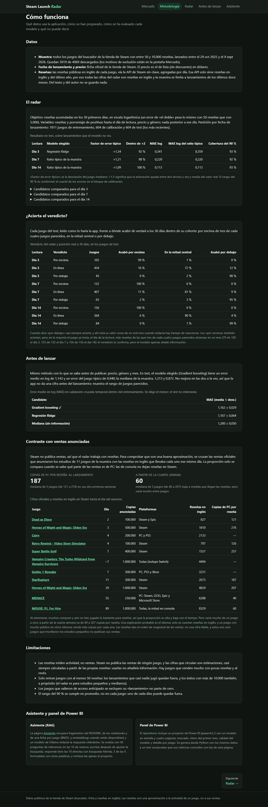
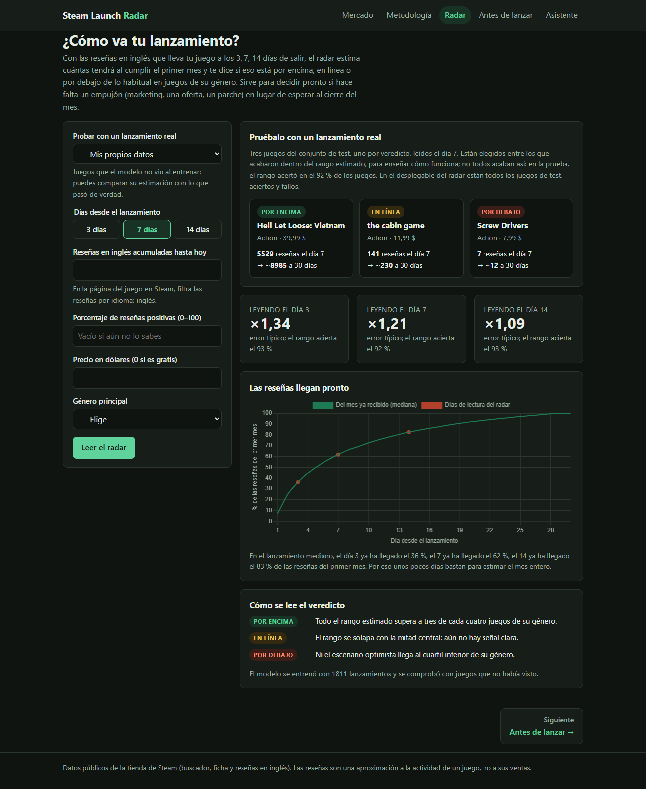
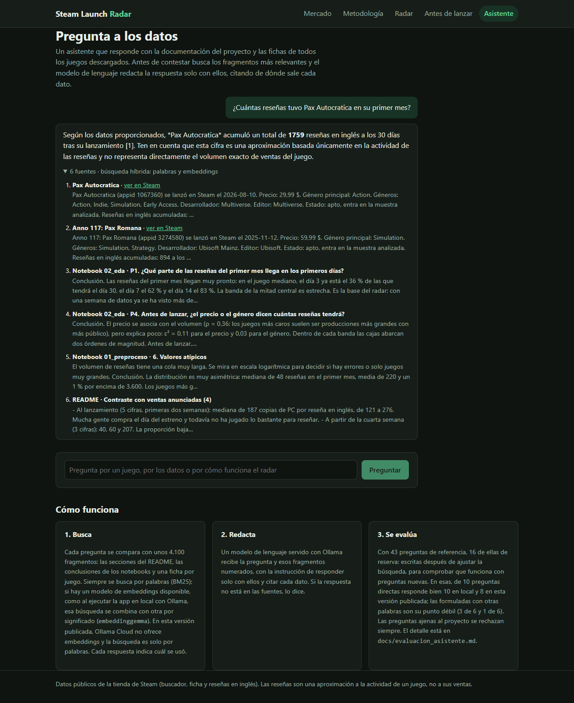
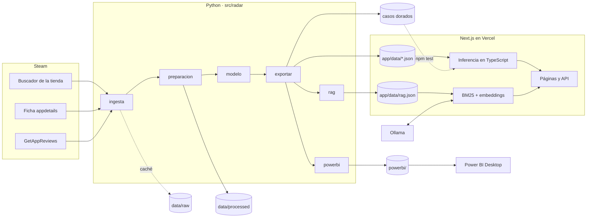

# Steam Launch Radar

Estima con las reseñas de los primeros días cuántas tendrá un juego de Steam al cumplir
su primer mes y si eso es mucho o poco para su género.

**Aplicación:** <https://steam-launch-radar.vercel.app>


Un estudio pequeño que publica un juego en Steam pasa el primer mes a ciegas: ve
entrar reseñas, pero no sabe si son muchas o pocas para un juego como el suyo hasta
que ya es tarde para reaccionar. **Steam Launch Radar** toma las reseñas de los
primeros 3, 7 o 14 días, estima cuántas tendrá el juego al cumplir 30 y dice si eso
está por encima, en línea o por debajo de lo habitual en su género. Antes del
lanzamiento, en lugar de inventar una cifra, enseña el rango de juegos parecidos.

Lo completan un **asistente con RAG** que responde preguntas sobre los datos y el
modelo citando sus fuentes, y un **panel de Power BI** con los indicadores de la
muestra y la calidad del modelo.

**Resultados clave**, sobre los 604 lanzamientos más recientes, que el modelo no vio
al entrenar:

- **Las reseñas llegan pronto:** el día 7 ya ha llegado el 62 % de las del primer mes.
- **La estimación del día 7 se desvía un ×1,21** en el juego típico (×1,09 el día 14),
  y su rango del 90 % acierta en el 92 % de los juegos.
- **Cuando el radar dice «por debajo» el día 7, acierta el 95 %** de las veces: avisa
  de un mal mes a tiempo de reaccionar.
- **A día 7 la regla simple empata con los modelos complejos**, y antes del
  lanzamiento ningún modelo mejora a decir «lo normal»: la app enseña un rango en
  lugar de inventar una cifra.
- **Las ventas que anunciaron diez estudios** confirman que las reseñas reflejan el
  orden de magnitud de las ventas, aunque no la cifra exacta.

---

## 1. Problema y usuario

El usuario es quien lleva el lanzamiento en un estudio indie o en un editor pequeño.
En la primera semana tiene que decidir si refuerza el marketing, adelanta una oferta o
prioriza un parche, y solo cuenta con un número suelto: las reseñas que lleva. Con el
radar introduce ese número (más el precio, el género y el porcentaje de positivas) y
obtiene:

- una estimación de las reseñas a 30 días con un rango del 90 %,
- dónde queda frente a los lanzamientos de su género,
- un veredicto que solo se pronuncia cuando todo el rango queda por encima o por
  debajo de lo normal.

Antes no tenía con qué compararse: SteamDB o la propia tienda muestran juegos uno a
uno, no cómo suele evolucionar un lanzamiento parecido en su primer mes.

## 2. Datos

| Fuente                                                                   | Qué aporta                                                                          | Acceso                                                                                |
| ------------------------------------------------------------------------ | ----------------------------------------------------------------------------------- | ------------------------------------------------------------------------------------- |
| Buscador de la tienda de Steam (`store.steampowered.com/search/results`) | Todos los lanzamientos de un periodo, ordenados por fecha, con su número de reseñas | Sin clave; la ruta `/search/` no está excluida en el `robots.txt`                     |
| Ficha de la tienda (`store.steampowered.com/api/appdetails`)             | Fecha de lanzamiento, precio de lista en dólares y géneros                          | Sin clave, unas 200 peticiones cada 5 minutos                                         |
| Steam Web API (`IUserReviewsService/GetAppReviews`)                      | Fecha y voto de cada reseña pública                                                 | Sin clave; [condiciones de la Steam Web API](https://steamcommunity.com/dev/apiterms) |

- **Muestra:** todos los juegos del buscador lanzados entre el 29-10-2025 y el
  09-09-2026 con entre 50 y 10.000 reseñas: 4.069 juegos, de los que 3.019 son aptos
  para el modelo. Descarga del 24-10-2026. El recuento del buscador cuenta todos los
  idiomas en los juegos con pocas reseñas, pero en los grandes Steam lo calcula solo
  con las del idioma de quien consulta (inglés en la ingesta): el mínimo de 50 se
  aplica sobre todas las reseñas y el tope de 10.000, en los juegos grandes, sobre las
  de inglés.
- **Dos límites de la API sin clave**, comprobados al construir la ingesta: solo
  devuelve reseñas en inglés y solo las del último año. El inglés es el 41 % de las
  reseñas en el juego mediano (medido en los 3.008 juegos con hasta 500, donde el
  buscador cuenta todos los idiomas); el límite del año apenas afecta a los juegos
  aptos. Por eso todas las cifras son reseñas en inglés y la muestra se limita a los
  lanzamientos de los últimos doce meses.
- **Por qué reseñas y no ventas:** Steam no publica las ventas de ningún juego, ni en
  la tienda ni en sus APIs. Las cifras que circulan son estimaciones: SteamSpy da
  rangos amplios de propietarios, y otras webs multiplican las reseñas por un factor.
  Usar esas estimaciones como objetivo sería circular (el modelo aprendería a
  predecir las reseñas multiplicadas por una constante) y llamarlo «ventas» daría una
  precisión falsa. Las reseñas son el indicador público más directo de cuánta gente
  juega a un juego, y el que la industria usa como termómetro de sus ventas.
- **Privacidad:** de cada reseña solo se guardan la fecha y el voto, agregados por día.
  El texto y el identificador del autor se descartan al leer la página.
- **Ventas anunciadas:** `data/external/ventas_anunciadas.csv`, recogidas a mano de
  comunicados de los estudios y la prensa especializada, con el enlace a cada fuente
  (ver [Contraste con ventas anunciadas](#contraste-con-ventas-anunciadas)).
- **Obtención:** `python -m radar.ingesta` descarga todo (1-2 horas por los límites de
  las APIs; se puede cortar y reanudar). Las tablas procesadas ya vienen en el
  repositorio, así que no hace falta para usar la app.

Diccionario de las tablas de `data/processed/`:

| Tabla                 | Filas                                              | Columnas principales                                                                                                                                          |
| --------------------- | -------------------------------------------------- | ------------------------------------------------------------------------------------------------------------------------------------------------------------- |
| `juegos.csv`          | 4.069                                              | `appid`, `nombre`, `fecha_lanzamiento`, `precio_usd`, `genero_principal`, `banda_precio`, `resenas_30d`, `pct_previas`, `estado` (apto o motivo de exclusión) |
| `resenas_diarias.csv` | una por juego y día con reseñas, del día −30 al 89 | `appid`, `dia` (0 = lanzamiento), `positivas`, `negativas`, `resenas`                                                                                         |
| `dataset_radar.csv`   | 3.019                                              | variables previas al lanzamiento, `resenas_{3,7,14}d`, `pct_positivas_{3,7,14}d` y el objetivo `resenas_30d`                                                  |

## 3. Preprocesamiento y EDA

[`notebooks/01_preproceso.ipynb`](notebooks/01_preproceso.ipynb) recorre la limpieza
con los datos reales; la lógica vive en `src/radar/preparacion.py`.

- Cada reseña se sitúa en su día relativo a la fecha oficial de lanzamiento.
- Se excluyen 689 juegos sin ninguna reseña en inglés en su primer mes, 357 con más del
  5 % de sus reseñas antes de la fecha oficial (salieron de acceso anticipado, el
  _early access_ de Steam: su día 0 no es un estreno) y 4 sin precio en dólares.
- El volumen es muy asimétrico (mediana de 48 reseñas a 30 días, media de 220): se
  trabaja en log(1 + reseñas). Los juegos más grandes son lanzamientos reales y no se
  recortan.

[`notebooks/02_eda.ipynb`](notebooks/02_eda.ipynb) responde siete preguntas. Las que
deciden el producto:

- **Las reseñas llegan pronto:** el día 3 ya está el 36 % del mes, el día 7 el 62 % y
  el día 14 el 83 %. Esperar al día 30 es perder tiempo de reacción.
- **La relación es casi lineal en log** (ρ de Spearman de 0,98 entre el día 7 y el 30): la
  regla «reseñas de hoy × multiplicador típico» ya es un baseline exigente.
- **La opinión temprana cuenta:** con el mismo volumen a día 7, un juego con el 60 % o
  menos de positivas acaba un 21 % por debajo de lo esperado.
- **Antes de lanzar, el precio y el género explican poco** (ε² de 0,11 y 0,03): sirven
  para situar un rango, no para dar una cifra.
- **Sesgo de selección:** la mediana a 30 días sube trimestre a trimestre (36 → 60)
  porque los lanzamientos recientes necesitan ser más grandes para tener 50 reseñas el
  día de la descarga.

## 4. Ciencia de datos

[`notebooks/03_modelo.ipynb`](notebooks/03_modelo.ipynb) y `src/radar/modelo.py`.

- **Objetivo:** log(1 + reseñas en inglés a 30 días).
- **Partición por fecha de lanzamiento:** 1.811 juegos de entrenamiento, 604 de
  calibración y 604 de test (los más recientes, de julio a septiembre de 2026).
- **Candidatos:** la mediana, el ratio típico de la muestra (la regla de la hoja de
  cálculo), Ridge y gradient boosting. Se elige por validación cruzada temporal dentro
  del entrenamiento; el test se usa una sola vez.
- **Intervalo del 90 %:** conformal, con el cuantil de los errores en el bloque de
  calibración.

Resultado en test, sobre lanzamientos que el modelo no vio:

| Lectura         | Modelo elegido    | Factor de error típico    | Dentro de ×2 | Cobertura del rango del 90 % |
| --------------- | ----------------- | ------------------------- | ------------ | ---------------------------- |
| Día 3           | Ridge             | ×1,34                     | 92 %         | 93 %                         |
| Día 7           | Ratio típico      | ×1,21                     | 98 %         | 92 %                         |
| Día 14          | Ratio típico      | ×1,09                     | 99,5 %       | 93 %                         |
| Antes de lanzar | Gradient boosting | ×2,56 (la mediana: ×2,39) | 37 %         | 92 %                         |

«Factor de error típico» es la desviación en el juego mediano: ×1,21 significa que la
estimación queda entre un 17 % por debajo y un 21 % por encima del valor real.

- **A día 7 y 14 gana la regla simple.** Ridge y gradient boosting quedan dentro del
  ruido entre pliegues, y casi todo el peso está en las reseñas acumuladas. Se respeta
  lo que dice la validación: más complejidad sin mejora fuera de muestra solo añade
  riesgo.
- **Antes de lanzar no hay modelo útil.** El elegido baja el error medio pero empeora el
  del juego típico, también sin el mes de lanzamiento. Por eso la app no da una cifra
  previa y muestra el rango de juegos parecidos.
- **Limitaciones:** las reseñas en inglés son una aproximación a la actividad, no a las
  ventas; la muestra deja fuera los lanzamientos con menos de 50 reseñas y los éxitos
  con más de 10.000; en el periodo de test el modelo sobreestima en torno a un 11 % los
  juegos de 10 a 200 reseñas a día 7 (el rango lo absorbe, pero hay que vigilarlo al
  reentrenar).

### ¿Acierta el veredicto?

El error de la estimación no dice si el veredicto sirve para decidir. Para eso,
`aciertos_veredicto` (`src/radar/exportar.py`) lee cada juego del test como lo haría
la app y lo compara con dónde acabó de verdad a 30 días dentro de su cohorte:

| Lectura | Veredicto  | Juegos | Acabó por encima | En la mitad central | Acabó por debajo |
| ------- | ---------- | ------ | ---------------- | ------------------- | ---------------- |
| Día 3   | Por encima | 105    | 99 %             | 1 %                 | 0 %              |
| Día 3   | En línea   | 454    | 16 %             | 72 %                | 12 %             |
| Día 3   | Por debajo | 45     | 0 %              | 2 %                 | 98 %             |
| Día 7   | Por encima | 132    | 100 %            | 0 %                 | 0 %              |
| Día 7   | En línea   | 407    | 11 %             | 81 %                | 9 %              |
| Día 7   | Por debajo | 65     | 2 %              | 3 %                 | 95 %             |
| Día 14  | Por encima | 156    | 100 %            | 0 %                 | 0 %              |
| Día 14  | En línea   | 364    | 6 %              | 90 %                | 4 %              |
| Día 14  | Por debajo | 84     | 0 %              | 1 %                 | 99 %             |

- **El valor está en el «por debajo»:** acierta el 95-99 % de las veces y avisa de un mal
  mes cuando todavía hay tiempo de reaccionar. No hay atajo posible: depende de lo que
  estima el modelo.
- **El «por encima» acierta casi siempre, pero casi siempre es trivial:** el juego ya
  tenía, el día de la lectura, más reseñas de las que tres de cada cuatro juegos
  parecidos alcanzan en un mes (79 de 105 el día 3, 125 de 132 el día 7, 156 de 156 el día 14). El veredicto lo confirma; el modelo apenas
  añade información, salvo algo el día 3.
- **El «en línea» acierta el 72-90 %** según el día, y es el veredicto más frecuente: el
  radar solo se pronuncia cuando todo el rango queda fuera de la mitad central.

### Contraste con ventas anunciadas

Steam no publica ventas, pero algunos estudios anuncian las suyas.
[`data/external/ventas_anunciadas.csv`](data/external/ventas_anunciadas.csv) recoge
11 cifras oficiales de 10 juegos de la muestra, cada una con su fecha, sus
plataformas y la fuente, y `python -m radar.ventas` las cruza con las reseñas en inglés
que llevaba cada juego ese mismo día (con el mismo criterio de días que el radar).

| Juego                                                                                                                                                        | Día | Copias anunciadas | Plataformas                            | Reseñas en inglés | Copias de PC por reseña |
| ------------------------------------------------------------------------------------------------------------------------------------------------------------ | --- | ----------------- | -------------------------------------- | ----------------- | ----------------------- |
| [Dead as Disco](https://3dnews.ru/1141383)                                                                                                                   | 2   | 100.000           | Steam y Epic                           | 827               | 121                     |
| [Heroes of Might and Magic: Olden Era](https://www.rpgsite.net/news/20297-heroes-of-might-and-magic-olden-era-sales-numbers-500k-copies-less-than-72-hours)  | 3   | 500.000           | Steam                                  | 1.810             | 276                     |
| [Cairn](https://www.pushsquare.com/news/2026/02/ps5-climbing-game-cairn-is-the-first-success-story-of-2026)                                                  | 4   | 200.000           | PC y PS5                               | 2.133             | —                       |
| [Retro Rewind - Video Store Simulator](https://newsletter.gamediscover.co/p/how-retro-rewinds-perfect-theme-hit)                                             | 4   | 100.000           | Steam                                  | 797               | 126                     |
| [Vampire Crawlers: The Turbo Wildcard from Vampire Survivors](https://nintendoeverything.com/vampire-crawlers-sales-surpass-1-million-in-one-week/)          | ~7  | 1.000.000         | Todas (incluye Switch)                 | 4.494             | —                       |
| [Super Battle Golf](https://www.shacknews.com/article/148048/super-battle-golf-400k-copies-sold)                                                             | 7   | 400.000           | Steam                                  | 1.557             | 257                     |
| [Gothic 1 Remake](https://thqnordic.com/news/half-a-million-nameless-heroes-gothic-1-remake-sells-500-000-copies-in-first-week)                              | 7   | 500.000           | PC, PS5 y Xbox                         | 3.231             | —                       |
| [StarRupture](https://www.gamesmarket.global/creepy-jars-starrupture-significantly-exceeds-expectations/)                                                    | 11  | 500.000           | Steam                                  | 2.673             | 187                     |
| [Heroes of Might and Magic: Olden Era](https://www.rpgsite.net/news/20468-heroes-of-might-magic-olden-era-sales-1-million-copies-steam-early-access-roadmap) | 29  | 1.000.000         | Steam                                  | 4.824             | 207                     |
| [MENACE](https://www.gamespress.com/en-US/MENACE-250000-copies-sold)                                                                                         | 55  | 250.000           | PC: Steam, GOG, Epic y Microsoft Store | 6.288             | 40                      |
| [MOUSE: P.I. For Hire](https://www.gematsu.com/2026/07/mouse-p-i-for-hire-sales-top-one-million)                                                             | 89  | 1.000.000         | Todas, la mitad en consola             | 8.329             | 60                      |

La proporción solo se compara cuando se sabe qué parte de las ventas es de PC, porque
las de consola no dejan reseñas en Steam. «PC» incluye otras tiendas (Epic, GOG) cuando
el anuncio no las separa, frente a reseñas que son solo de Steam.

- **Al lanzamiento** (5 cifras, primeras dos semanas): mediana de
  **187 copias de PC por reseña en inglés**, de 121 a 276. Mucha gente compra el día
  del estreno y todavía no ha jugado lo bastante para reseñar.
- **A partir de la cuarta semana** (3 cifras): 40, 60 y 207. La proporción
  baja con el tiempo, pero varía mucho de un juego a otro. Las dos más bajas quedan cerca
  de las 30-60 copias por reseña que estima la industria
  ([VG Insights](https://wp.vginsights.com/further-analysis-into-steam-reviews-to-sales-ratio-how-to-estimate-video-game-sales/2),
  [Gamalytic](https://gamalytic.com/blog/a-deep-dive-into-the-steam-review-ratio)), que
  cuenta reseñas en todos los idiomas; Heroes of Might and Magic: Olden Era la
  multiplica por más de tres. Una explicación probable, no comprobada, es el idioma: solo
  se cuentan reseñas en inglés, y una saga con mucho público en otros idiomas vende más
  copias por cada una.
- **Conclusión:** las reseñas dan el orden de magnitud de las ventas, pero no una cifra
  fiable: la proporción depende del momento, del público de cada juego y de cuánto se
  vende en consola. Por eso el radar predice reseñas y no las convierte en ventas.
- **Límites:** son éxitos, muy lejos del juego típico de la muestra (48 reseñas al
  mes), porque los estudios pequeños no publican sus ventas; solo 3 cifras caen a partir
  de la cuarta semana; la fecha de Vampire Crawlers es aproximada. SteamSpy, la fuente
  gratuita de estimaciones, no tiene datos de los juegos lanzados desde finales de 2025.

### Asistente (RAG)

`src/radar/rag.py` construye el índice y `app/src/lib/rag.ts` hace la recuperación.

- **Corpus:** 4.114 fragmentos. 45 salen del README y de las celdas de texto de los
  notebooks, cortados por secciones, y el resto son una ficha por juego descargado con
  sus cifras (precio, géneros, estudio, reseñas los días 3, 7, 14 y 30, y por qué se
  excluyó si es el caso).
- **Recuperación:** BM25 sobre las palabras y similitud de coseno sobre embeddings
  de `embeddinggemma` (Ollama), combinados con Reciprocal Rank Fusion. Los vectores
  se guardan normalizados y cuantizados a int8, así que el índice entero pesa 6 MB y
  no hace falta una base de datos vectorial. En la búsqueda híbrida las palabras se
  reducen a una raíz de 6 letras («opiniones» y «opinión» cuentan igual). Entre los
  seis fragmentos que recibe el modelo entran como mucho dos fichas de juegos, para
  que no desplacen a la documentación.
- **Generación:** un modelo servido con Ollama (`qwen3.5` en local, `gpt-oss:120b`
  de Ollama Cloud en Vercel) recibe esos fragmentos con la instrucción de responder
  solo con ellos y citar cada dato con su número.
- **Evaluación** (`npm run evaluar-asistente`, detalle en
  [`docs/evaluacion_asistente.md`](docs/evaluacion_asistente.md)): 43 preguntas de
  referencia, cada una con las secciones que contienen la respuesta. 24 son de
  **ajuste** (con ellas se decidió cómo busca el asistente) y 16 de **reserva**,
  escritas después para comprobar que esas decisiones generalizan. En los dos grupos
  hay preguntas directas y **reformuladas** sin las palabras de la documentación
  («¿cuánto se equivoca la herramienta una semana después del estreno?»). Otras 3
  son ajenas al proyecto.

| Respuestas con el dato esperado | Ajuste: directas | Ajuste: reformuladas | Reserva: directas | Reserva: reformuladas |
| ------------------------------- | ---------------- | -------------------- | ----------------- | --------------------- |
| Híbrida (local)                 | 19/19            | 2/5                  | 10/10             | 3/6                   |
| Solo palabras (en Vercel)       | 18/19            | 1/5                  | 8/10              | 1/6                   |

En los dos modos las respuestas citan su fuente y las 3 preguntas ajenas se rechazan,
con unos 2 segundos por respuesta.

- **Qué se aprendió midiendo:** reducir las palabras a su raíz mejora la búsqueda
  híbrida pero empeora la de solo palabras (crea coincidencias falsas que los
  embeddings ya no compensan), así que cada modo usa lo que le funciona. Sin el cupo
  de fichas, una pregunta sobre _early access_ se llenaba de juegos con ese género.
  También se probó que el modelo de lenguaje reescribiera la pregunta en palabras
  clave antes de buscar sin embeddings: ayudaba algo con las reformuladas y empeoraba
  algo las directas, sin mejora neta, así que se descartó.
- **Limitaciones:** las preguntas reformuladas son el punto débil, sobre todo en la
  versión publicada, que busca solo por palabras porque Ollama Cloud no ofrece
  embeddings. Los grupos son pequeños y las respuestas del modelo varían entre
  ejecuciones (una o dos preguntas arriba o abajo en un grupo de 5 o 6), así que las
  diferencias pequeñas no son significativas. La comprobación busca la cifra o el
  término esperado, de modo que una respuesta correcta redactada de otra forma cuenta
  como fallo; el informe guarda cada respuesta para revisarlas.

## 5. La aplicación

Las secciones siguen el orden en que se cuenta el proyecto, y cada página termina con un
enlace a la siguiente.

| Sección              | Qué hace                                                                                                                                                                                                                                                                                                                                                                                               |
| -------------------- | ------------------------------------------------------------------------------------------------------------------------------------------------------------------------------------------------------------------------------------------------------------------------------------------------------------------------------------------------------------------------------------------------------ |
| **Mercado** (`/`)    | La portada. Los hallazgos del EDA que explican el diseño del radar, seguidos de los indicadores de la muestra: ritmo del primer mes, géneros, precio, lanzamientos por mes y exclusiones.                                                                                                                                                                                                              |
| **Metodología**      | Datos, comparación de candidatos, métricas de test, acierto del veredicto, contraste con ventas anunciadas y limitaciones, leídos de los mismos JSON que usa el modelo, y un resumen del asistente y del panel.                                                                                                                                                                                        |
| **Radar** (`/radar`) | Estimación a 30 días, comparación con la cohorte, veredicto y trayectoria esperada. Se puede probar con 604 lanzamientos reales del test y ver lo que pasó después. Admite enlaces directos del tipo `/radar?juego=4113940&dia=7`. Antes de la primera lectura enseña tres casos reales (uno por veredicto) que se leen con un clic, la precisión del modelo según el día y cuándo llegan las reseñas. |
| **Antes de lanzar**  | Reseñas a 30 días de juegos del mismo género y precio (mediana y mitad central).                                                                                                                                                                                                                                                                                                                       |
| **Asistente**        | Chat con RAG: responde con la documentación y las fichas de los juegos, cita cada dato y enseña las fuentes recuperadas aunque el modelo de lenguaje no responda.                                                                                                                                                                                                                                      |

Las direcciones antiguas (`/mercado` y `/?juego=…`) redirigen a las nuevas.

API del servidor:

| Ruta                        | Respuesta                                                                                                                                                                                                                                              |
| --------------------------- | ------------------------------------------------------------------------------------------------------------------------------------------------------------------------------------------------------------------------------------------------------ |
| `POST /api/radar`           | Lectura del radar. Cuerpo: `dia` (3, 7 o 14), `resenas` (entero), `pct_positivas` (fracción de 0 a 1, opcional), `precio_usd` y `genero`.                                                                                                              |
| `POST /api/previo`          | Referencia antes de lanzar. Cuerpo: `precio_usd`, `mes_lanzamiento` (1-12) y `genero`.                                                                                                                                                                 |
| `GET /api/ejemplos/{appid}` | Ficha y reseñas diarias reales de un lanzamiento del test.                                                                                                                                                                                             |
| `POST /api/asistente`       | Respuesta del asistente en NDJSON: una línea con las fuentes, los trozos de texto según se generan y una de cierre o error. Cuerpo: `mensajes` (lista de `{rol, texto}`, el último del usuario). Como mucho 20 preguntas por IP cada 10 minutos (429). |

Las entradas se validan en el formulario y otra vez en el servidor, con mensajes que
nombran el campo erróneo (400). Si faltan los datos exportados, las páginas y la API
lo dicen y explican cómo generarlos (503). Si Ollama no responde, el asistente lo
dice con un mensaje claro y deja a la vista los fragmentos que encontró.

### Panel de inteligencia (Power BI)

[`powerbi/SteamLaunchRadar.pbip`](powerbi/) es un proyecto de Power BI en formato de
texto (modelo semántico en TMDL e informe en PBIR). Se generó desde Python con
`python -m radar.powerbi --proyecto` y después se guardó con Power BI Desktop; cada mes,
`python -m radar.powerbi` solo renueva sus CSV, para no descartar lo guardado en Desktop.
Cada página responde a una pregunta:

| Página                   | Pregunta                                       | Contenido                                                                      |
| ------------------------ | ---------------------------------------------- | ------------------------------------------------------------------------------ |
| **Mercado**              | ¿Cómo es un lanzamiento típico en Steam?       | Lanzamientos, mediana de reseñas y de positivas, por mes, género y precio      |
| **Ritmo del primer mes** | ¿Cuándo llegan las reseñas?                    | Parte del mes recibida día a día y en los días 3, 7 y 14                       |
| **Calidad del modelo**   | ¿Cuánto acierta el radar en juegos que no vio? | Factor de error, cobertura del rango, estimación frente a realidad, candidatos |
| **Detalle por juego**    | ¿Qué estimó para cada juego del test?          | Tabla con la lectura, el rango y el valor real                                 |

El modelo es una estrella: `juegos`, `calendario` y `lecturas` como dimensiones, y
`curva_diaria`, `predicciones` y `metricas` como hechos. Las consultas leen los CSV de
`powerbi/datos/` desde GitHub, así que el panel se actualiza con «Actualizar» cuando
llegan datos nuevos; el parámetro `OrigenDatos` admite también una carpeta local. Un
test comprueba que el factor de error y la cobertura del panel coinciden con los de la
app.

| Mercado                                               | Metodología                                   | Radar antes de la primera lectura                                                 |
| ----------------------------------------------------- | --------------------------------------------- | --------------------------------------------------------------------------------- |
|                  |  |                                    |
| **Antes de lanzar**                                   | **Asistente**                                 | **Móvil**                                                                         |
|  |      |  |

## 6. Arquitectura y stack



- **Ingesta:** `requests` con reintentos, respeto de `Retry-After` y una pausa por
  fuente. Cada paso guarda en `data/raw/` de forma atómica, así que una descarga
  cortada se reanuda donde se quedó.
- **Datos y modelo:** pandas y scikit-learn (Ridge, gradient boosting,
  `TimeSeriesSplit`), con el intervalo conformal escrito a mano.
- **Aplicación:** Next.js 16 (App Router), React 19, TypeScript y Chart.js. No hay
  base de datos ni Python en producción: los modelos viajan como JSON y se evalúan en
  el servidor de Next.
- **Asistente:** Ollama para los embeddings (`embeddinggemma`) y la generación
  (`qwen3.5` en local, un modelo de Ollama Cloud en Vercel). BM25, el coseno y la
  fusión están escritos en TypeScript, sin dependencias.
- **Panel:** Power BI Desktop con un proyecto `.pbip` (TMDL y PBIR) generado desde
  Python; los JSON del informe validan contra los esquemas públicos de Microsoft.
- **Calidad:** ruff, pytest con cobertura mínima del 90 %, ESLint, Prettier,
  `tsc --noEmit`, tests de Node y una prueba de humo contra el build de producción.
  Gitleaks revisa todo el historial en busca de secretos.
- **Automatización:** dos workflows de GitHub Actions. `ci.yml` ejecuta todas las
  comprobaciones en cada push y Pull Request. `actualizar-datos.yml` se lanza el día 1
  de cada mes (o a mano): descarga los lanzamientos nuevos, reentrena, reejecuta los
  notebooks y los tests, y abre un Pull Request con los datos y un resumen de las
  métricas para revisarlo antes de publicar. Vercel despliega cada push a `main`.

## 7. Instalación y ejecución

Requisitos: Python 3.13 y Node.js 22.18 o superior (los tests y la evaluación del
asistente ejecutan TypeScript directamente, algo que Node admite desde esa versión).

```bash
git clone https://github.com/alvarodc093-pixel/steam-launch-radar.git
cd steam-launch-radar
```

**Solo la aplicación** (los datos y modelos ya vienen en el repositorio):

```bash
cd app
npm ci
npm run dev                       # http://localhost:3000
```

**Entorno de Python** (para regenerar datos, notebooks o modelos y pasar sus tests):

```bash
python -m venv .venv
source .venv/bin/activate         # Windows: .venv\Scripts\activate
pip install -r requirements.txt
```

Rehacer todo desde cero:

```bash
python -m radar.ingesta           # descarga de Steam (1-2 h, reanudable)
python -m radar.preparacion       # data/processed/*.csv
python -m radar.exportar          # app/data/*.json y casos dorados de la app
python -m radar.rag               # app/data/rag.json (índice del asistente; necesita Ollama)
python -m radar.ventas            # app/data/ventas.json (contraste con ventas anunciadas)
python -m radar.powerbi           # powerbi/datos/*.csv (--proyecto: también el .pbip)
python -m radar.informe           # resumen de métricas en Markdown
```

La ingesta no necesita clave. Opcionalmente, copiar `.env.example` a `.env` y poner un
correo de contacto, que se añade al User-Agent de las peticiones.

**Asistente en local.** Con [Ollama](https://ollama.com) instalado y abierto:

```bash
ollama pull embeddinggemma        # embeddings de las preguntas
ollama pull qwen3.5               # modelo que redacta las respuestas
cd app && npm run dev             # http://localhost:3000/asistente
npm run evaluar-asistente         # vuelve a medir la calidad (unos 2 minutos)
```

Sin Ollama la app funciona igual y el asistente explica que no puede responder,
enseñando las fuentes que encontró. Para cambiar de modelo, copiar `.env.example` a
`app/.env.local` y ajustar las variables `OLLAMA_*`.

**Panel de Power BI.** Instalar [Power BI Desktop](https://aka.ms/pbidesktopstore)
(gratuito, Windows), abrir `powerbi/SteamLaunchRadar.pbip` y pulsar **Inicio →
Actualizar** para cargar los datos. Para entregarlo como un único archivo: **Archivo →
Guardar como → .pbix**.

### Comprobaciones

| Dónde  | Comando                                                     | Qué cubre                                                                                                     |
| ------ | ----------------------------------------------------------- | ------------------------------------------------------------------------------------------------------------- |
| Raíz   | `ruff check . && ruff format --check .`                     | Estilo y errores en `src/`, `tests/` y notebooks                                                              |
| Raíz   | `pytest --cov`                                              | 80 tests de ingesta, preparación, modelo, exportación, EDA, ventas, asistente y panel (cobertura del 98 %)    |
| `app/` | `npm run lint && npm run format:check && npm run typecheck` | ESLint, Prettier y tipos                                                                                      |
| `app/` | `npm test`                                                  | Inferencia en TypeScript frente a 2.416 casos calculados en Python, y recuperación y validación del asistente |
| `app/` | `npm run evaluar-asistente`                                 | Calidad del asistente con Ollama (recuperación y respuestas)                                                  |
| `app/` | `npm run build && npm run humo`                             | Arranca el build de producción y prueba páginas y API                                                         |

### Despliegue en Vercel

En Vercel, «Add New Project», importar el repositorio y fijar **Root Directory =
`app`**. El radar no necesita variables de entorno. El asistente sí, porque Vercel no
llega al Ollama de un equipo local: `OLLAMA_HOST=https://ollama.com`, `OLLAMA_API_KEY`
con una clave de [ollama.com/settings/keys](https://ollama.com/settings/keys) y
`OLLAMA_MODELO` con un modelo de la nube (por ejemplo `gpt-oss:120b`). Sin ellas, el
asistente responde con el aviso y las fuentes encontradas.

### Actualización mensual de los datos

El workflow necesita permiso para abrir Pull Requests: en GitHub, _Settings → Actions →
General → Workflow permissions_, marcar «Read and write permissions» y «Allow GitHub
Actions to create and approve pull requests». Se puede lanzar a mano desde la pestaña
_Actions_ con «Run workflow».

## 8. Estructura del repositorio

```
steam-launch-radar/
├── .github/workflows/
│   ├── ci.yml                    lint, tests, build, humo y gitleaks
│   └── actualizar-datos.yml      reentrenamiento mensual con Pull Request
├── data/
│   ├── raw/                      caché de la ingesta (no se versiona)
│   ├── external/                 ventas anunciadas por los estudios, con su fuente
│   └── processed/                juegos, reseñas diarias y dataset del modelo
├── notebooks/                    01_preproceso · 02_eda · 03_modelo
├── src/radar/
│   ├── config.py                 rutas, ventana de lanzamientos y umbrales
│   ├── ingesta/                  buscador, ficha y reseñas de Steam
│   ├── preparacion.py            limpieza, exclusiones y variables
│   ├── eda.py                    cifras del EDA que también enseña la app
│   ├── modelo.py                 partición temporal, candidatos e intervalo conformal
│   ├── exportar.py               modelos y tablas para la app
│   ├── rag.py                    índice del asistente (fragmentos y embeddings)
│   ├── ventas.py                 contraste de las reseñas con las ventas anunciadas
│   ├── powerbi.py                tablas en estrella y proyecto de Power BI
│   └── informe.py                resumen de métricas
├── tests/                        pytest
├── powerbi/
│   ├── datos/                    CSV del modelo en estrella
│   ├── SteamLaunchRadar.pbip     se abre con Power BI Desktop
│   ├── SteamLaunchRadar.SemanticModel/   tablas, relaciones y medidas DAX (TMDL)
│   └── SteamLaunchRadar.Report/  páginas y visuales (PBIR)
├── app/
│   ├── data/                     modelos, tablas e índice del asistente
│   ├── src/app/                  páginas y rutas de la API
│   ├── src/components/           formularios y gráficos
│   ├── src/lib/                  inferencia, validación y lectura de datos
│   ├── tests/                    casos dorados, preguntas de referencia y tests de Node
│   └── scripts/                  prueba de humo y evaluación del asistente
├── docs/
│   ├── capturas/
│   └── evaluacion_asistente.md   resultado de la última evaluación del asistente
├── requirements.txt              versiones exactas; instala también el paquete radar
├── pyproject.toml                ruff, pytest y cobertura
└── LICENSE
```

## 9. Decisiones técnicas y aprendizajes

- **Medir la API antes de diseñar la muestra.** La documentación no dice que, sin
  clave, `GetAppReviews` solo devuelve reseñas en inglés y del último año. Lo descubrí
  comparando sus recuentos con los de la tienda, y cambió el proyecto: el objetivo pasó
  a ser «reseñas en inglés» y la ventana, los últimos doce meses.
- **El baseline primero.** El ratio típico se implementó antes que cualquier modelo, y a
  días 7 y 14 nadie le gana fuera de muestra. Mantenerlo en producción es más honesto y
  más robusto que elegir el modelo que mejor queda en test.
- **No dar una cifra cuando el modelo no sirve.** Antes del lanzamiento ningún candidato
  mejora a la mediana en el juego típico, así que la app muestra un rango de juegos
  parecidos en lugar de una predicción.
- **Inferencia en TypeScript con casos dorados.** Exportar coeficientes y árboles a JSON
  evita un servicio de Python en producción. El riesgo es que las dos implementaciones
  diverjan, y lo cubren los 2.416 casos que Python calcula y la app tiene que reproducir
  con una diferencia menor de 0,0001 en log.
- **El intervalo conformal, escrito a mano.** `np.quantile(method="higher")` no da el
  estadístico de orden ⌈(n+1)·0,9⌉ que exige la garantía de cobertura con muestras
  finitas. Se calcula de forma explícita y un test lo fija con una muestra pequeña.
- **El sesgo de selección no se ve en las métricas.** Exigir 50 reseñas el día de la
  descarga favorece a los lanzamientos recientes más grandes. Afecta poco al radar, que
  trabaja con proporciones, pero descarta el mes de lanzamiento como variable previa.
- **Medir la recuperación antes de complicarla.** Con preguntas directas BM25 basta;
  con preguntas reformuladas los embeddings pasan de no encontrar la fuente en ninguna
  a encontrarla en 3 de 5. Por eso el asistente combina las dos búsquedas cuando puede y, cuando no
  hay embeddings, baja a BM25 y lo dice en cada respuesta.
- **Fichas generadas, no texto libre.** Cada juego se describe con una plantilla a
  partir de las tablas procesadas, así que el asistente no puede citar una cifra que no
  esté en los datos del radar.
- **Power BI como código.** El panel se genera desde Python en formato de texto y lee
  los CSV desde GitHub: no hay rutas locales en el proyecto y la actualización mensual
  lo deja al día sin tocar Power BI.

## 10. Qué mejoraría con más tiempo

Lo que queda fuera no cabía en el plazo del proyecto o necesita datos que todavía no
existen:

- **Reseñas en todos los idiomas** con una clave de la Steam Web API, para incluir los
  juegos con público no anglófono que hoy se excluyen por no recibir reseñas en inglés.
- **Muestra sin sesgo de selección:** guardar el recuento del buscador cada mes y fijar
  la entrada por las reseñas del día 30, algo que la actualización mensual ya permite
  acumular.
- **Más señales tempranas,** como los jugadores simultáneos o los seguidores de la
  página de la tienda, para afinar la lectura del día 3, la más útil y la menos precisa.
- **Alertas:** seguir un juego por su `appid` y avisar al estudio cuando su lectura
  diaria cambie de veredicto.
- **Búsqueda híbrida también en la versión publicada,** con un servicio de embeddings
  en la nube, para que las preguntas reformuladas funcionen igual que en local.
- **Evaluar el asistente con preguntas reales** de quienes usen la app, en lugar de
  un conjunto escrito a mano, y medir también la calidad de la redacción.

## Convención de commits

Desde que el proyecto tiene CI y tests, los commits siguen
[Conventional Commits](https://www.conventionalcommits.org/es/) (los primeros, de la
construcción inicial, son frases descriptivas):
`tipo(ámbito): descripción` en imperativo o nominal, con los tipos `feat`, `fix`,
`refactor`, `test`, `docs`, `ci` y `chore`, y ámbitos como `ingesta`, `modelo`, `app`,
`datos` o `notebooks`. Ejemplo: `fix(modelo): estadístico de orden exacto en el
intervalo conformal`.

## Licencia

Código bajo licencia [MIT](LICENSE). Los datos proceden de Steam y están sujetos a sus
condiciones de uso.
